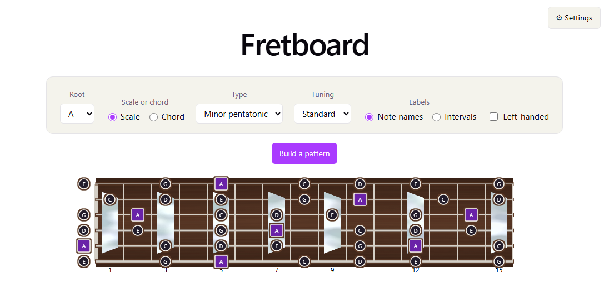

# Fretboard

A fretboard visualizer for guitarists. Pick a root note and a scale or chord, and
the matching notes are highlighted across the neck, with the root shown as a
distinct shape rather than just a colour.

**[Live demo](https://scf1001.github.io/fretboard-app/)**



## Features

- Highlights the notes of any scale or chord for any root
- Click or tap a note to hear its pitch
- Pattern builder — trace a playable fingering shape one note at a time, choosing
  from the nearest scale tones on the same or an adjacent string
- Note name or interval labels
- Standard, Drop D, DADGAD, or custom tunings
- Left-handed mode
- A choice of maple, rosewood or ebony fretboard, and of dot, block, trapezoid,
  sharktooth or no fret inlays (mother of pearl on the darker woods), both
  remembered between visits
- Your root, scale or chord, tuning and label choices are stored in the URL, so a
  configuration can be shared or bookmarked
- Responsive — the fretboard scrolls sideways on narrow screens
- Accessible — keyboard-navigable controls, ARIA labels describing what's
  highlighted, a live announcement when selections change,
  colour-blind-safe highlighting (shape and label, not colour alone), and note
  markers outlined to keep at least 3:1 contrast on every fretboard wood

## Stack

- [Vite](https://vite.dev/) + [React](https://react.dev/) + [TypeScript](https://www.typescriptlang.org/)
- [Tonal](https://github.com/tonaljs/tonal) for music theory (scales, chords, intervals, enharmonics)
- [Tone.js](https://tonejs.github.io/) for playing notes through the Web Audio API
- An SVG fretboard, no canvas or external rendering library, with the wood grain
  and mother-of-pearl inlays generated by SVG filters rather than images
- [Vitest](https://vitest.dev/) + [React Testing Library](https://testing-library.com/react) for tests
- ESLint + Prettier
- Deployed as a static site via GitHub Actions + GitHub Pages

## Development

```bash
npm install
npm run dev       # start the dev server
npm test          # run tests (watch mode)
npm run lint      # lint
npm run format    # format with Prettier
npm run build     # typecheck and build for production
```

GitHub Actions runs lint, format checks, tests, and a production build on every
push.
